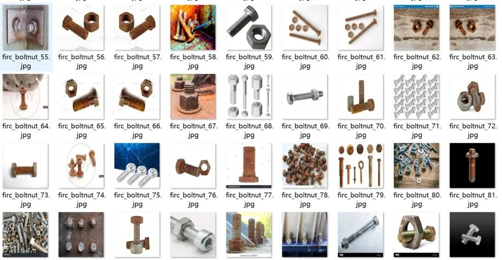
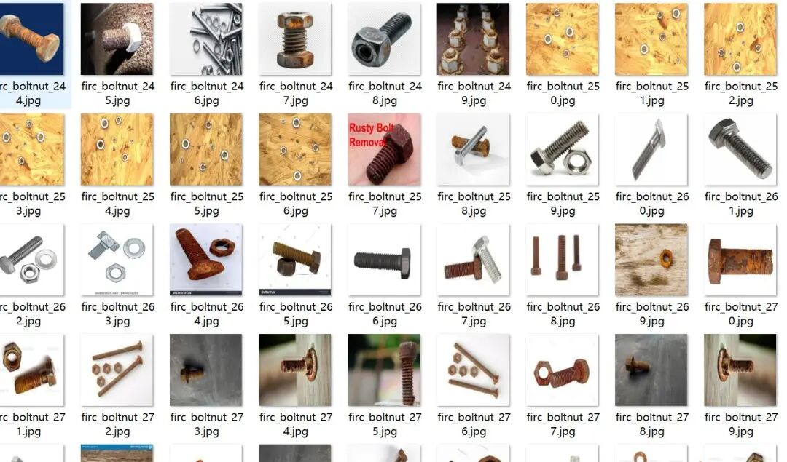
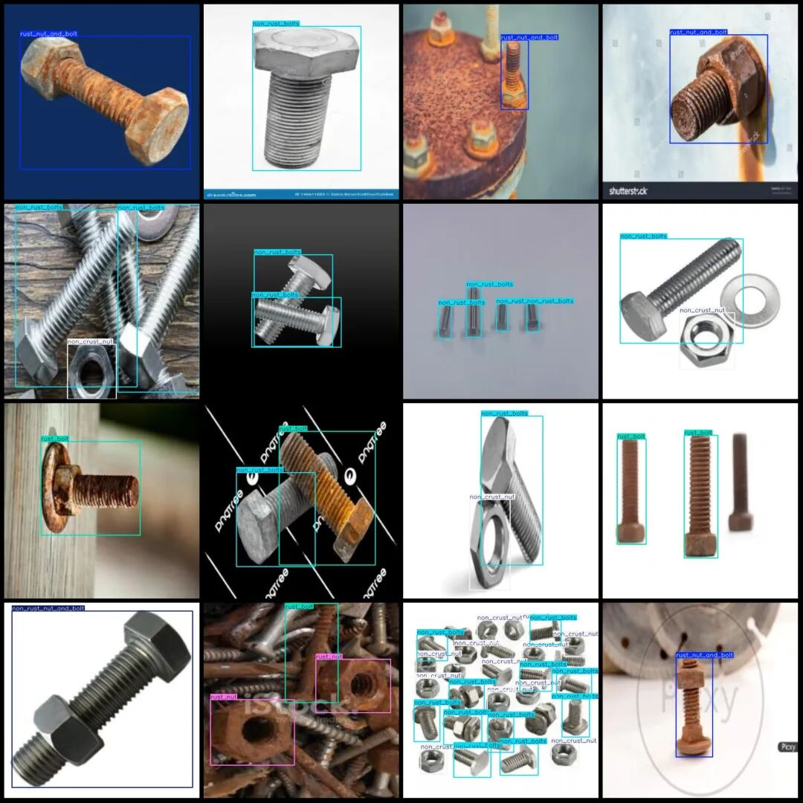
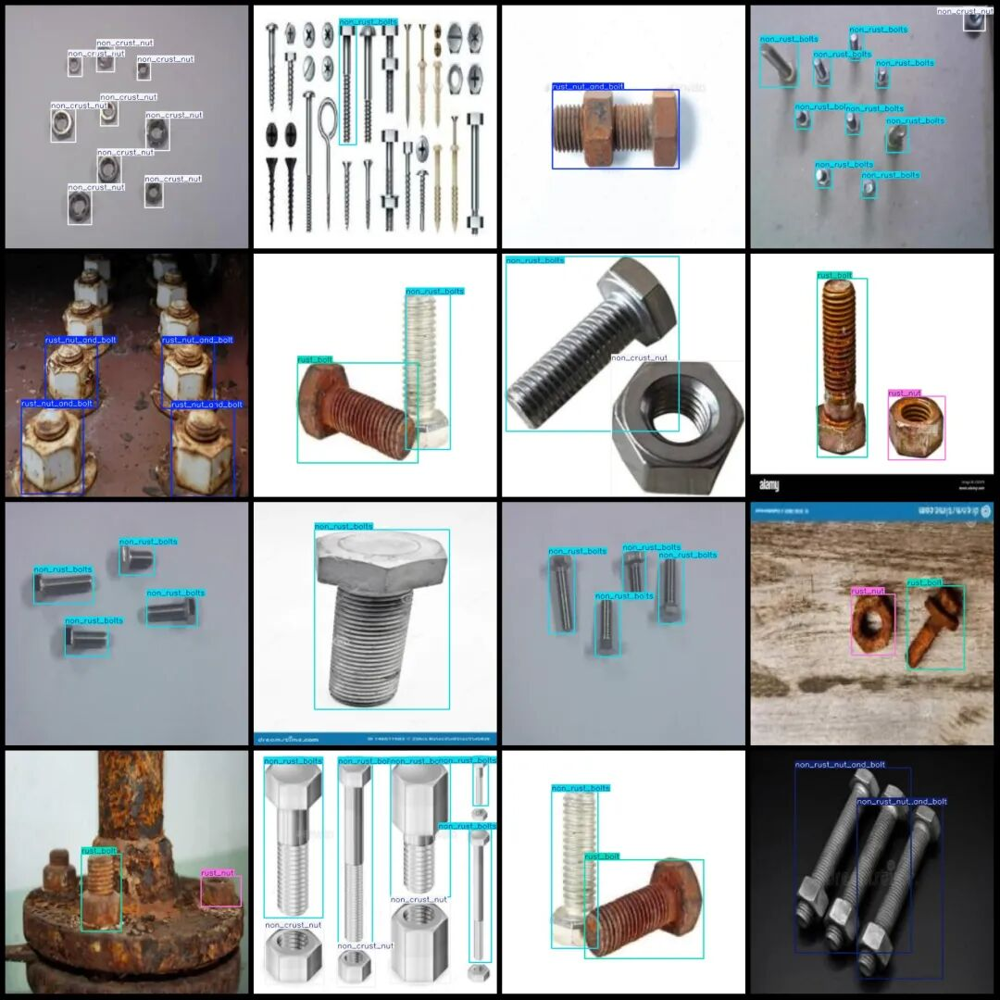

# Rotten and corroded detection dataset in VOC+YOLO format with 303 images across 6 categories

Dataset format: Pascal VOC format + YOLO format (txt file without split path, only containing jpg images and corresponding VOC format xml files and yolo format txt files)

Number of images (number of jpg files): 303

Number of annotations (number of xml files): 303

Number of annotations (number of txt files): 303

Label count: 6

Label category names (Note that the order of labels in the YOLO format does not correspond to this, but is based on the classes.txt file in the labels folder): ["non_crust_nut", "non_rust_bolts", "non_rust_nut_and_bolt", "rust_bolt", "rust_nut", "rust_nut_and_bolt"]

Number of boxes labeled in each category:

Non-Crust Nut (No-Rust Nut) Frame Count = 291

Non-rust bolts (non-rust bolts) frame count = 350

Non-rust Nut and Bolt (No Rust Nut and Bolt Combination) Frame Count = 41

Rust Bolt (rusty bolt) frame count = 180

Rust Nut (rusted nut) frame count = 81

Rust Nut and Bolt (rusty nut and bolt assembly) frame count = 80

Total frame count: 1023

Number of images per category:

non_crust_nut (non-rusted nut) occupying the image count = 74

non_rust_bolts (non-rust bolts) occupying the image count = 98

non_rust_nut_and_bolt (no rust nut and bolt combination) has 17 images.

Rust Bolt (rusty bolt) has 130 images.

Rust Nut (rusted nut) has a picture count = 50

Rust Nut and Bolt (rusty nut and bolt combination) has a picture count = 60

Image resolution: 640x640

Using labelImg:

Annotation rules: Draw a rectangle around the category.

Important Notice: The dataset does not have separate training, validation, and test sets; you need to partition them yourself.

Special : This dataset does not guarantee the accuracy of the trained models or weight files.

Image Preview:

Annotation example:

## Payment

Here is a pay link on Stripe ( https://buy.stripe.com/3cs8yP7sY87d0vu9AB ). Please contact me lonlonago@foxmail.com after funding $89, and I will send you a complete data files , thank you!

